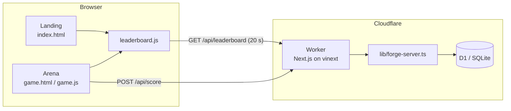
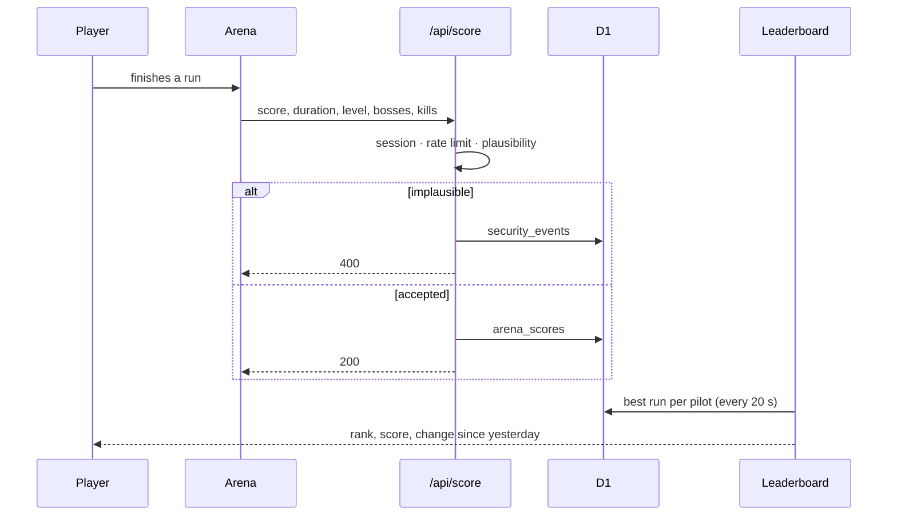

<p align="center">
  
</p>

<h1 align="center">$FORGE · Starforge Arena</h1>

<p align="center">
  <b>A browser arcade shooter with a pilot leaderboard, built for a Solana token launch.</b><br/>
  Hold the forge against the swarm, break a boss every forty seconds, climb the board.
</p>

<p align="center">
  
  
  
  
</p>

<p align="center"><a href="README.ru.md">Русская версия</a></p>


## What it is

Starforge is a fast, one-screen arcade shooter that runs in the browser with no install. Players pick a hull, survive a scrap swarm, defeat a boss every 40 seconds and push their best run onto a shared leaderboard. The landing page presents the game and the upcoming **$FORGE** token on Solana.

## How it works

1. **Play.** Pick a ship (Spark, Anvil or Flux) and survive. Shards build your weapon; bosses arrive on a timer.
2. **Submit.** When a signed-in player finishes a run, the game posts it to `POST /api/score`.
3. **Check.** The server rate-limits submissions and rejects runs that are impossible for their length (score, level, bosses and kills against duration). Rejected runs are written to a security log.
4. **Rank.** `GET /api/leaderboard` ranks every pilot by their best verified run and shows how each position moved since yesterday.
5. **Watch.** The board updates every 20 seconds without a reload. Rows glide to new positions; risers flash green, fallers red.

## Screenshots

| Arena | Leaderboard |
|---|---|
|  |  |
| **Hangar** | **Bosses** |
|  |  |

<p align="center"></p>

## Project status

Starforge is **pre-launch**. Be clear about what is live and what is not:

| Part | State |
|---|---|
| Landing page, arena, pilot campaign, hangar | Live in the build |
| Game accounts (ChatGPT sign-in), score API, leaderboard API | Implemented, tested |
| Leaderboard demo profiles | Generated in the browser, always tagged **DEMO**, never stored |
| $FORGE token, buy and chart links | **Not launched.** The contract address will be announced at launch |
| Server-side replay verification of runs | Not yet; see [Limitations](#limitations) |

## Architecture





## Repository structure

```
apps/
  arcade/                 deployable app (Next.js on vinext → Cloudflare Workers + D1)
    app/api/              score, leaderboard, profile, raid routes
    lib/forge-server.ts   framework-free server core (ranking, rate limits, checks, headers)
    db/ · drizzle/        schema and SQL migrations
    public/               landing, arena, leaderboard, assets (served as static files)
    scripts/              dev server and tests
packages/
  brand/                  logo, favicon, color tokens
docs/                     architecture, security, deployment (docs/ru — Russian notes)
.github/                  CI and README media
```

## Run locally

Requirements: **Node.js 22.13+**.

Quick look, no install needed (serves the site with a real leaderboard API on in-memory SQLite and a few sample players):

```bash
cd apps/arcade
node scripts/dev-forge-server.mjs public 8790
# open http://127.0.0.1:8790/index.html
```

Full app:

```bash
cd apps/arcade
corepack pnpm install
corepack pnpm dev        # vinext dev server
corepack pnpm build      # production build
```

Tests (no install needed, uses Node's built-in SQLite):

```bash
cd apps/arcade
node scripts/test-forge-server.mjs
```

Deployment, migrations and the online/offline switch are in [DEPLOY.md](DEPLOY.md).

## Security

- Opaque row keys: account ids never leave the server.
- Per-IP rate limits on the board (120/min) and on score submission (60/h).
- Plausibility checks on every run; rejected runs are logged to `security_events`.
- Strict CSP with no inline scripts, HSTS, `nosniff`, frame and referrer policies.

Details in [docs/security.md](docs/security.md). To report a vulnerability, see [SECURITY.md](SECURITY.md).

## Limitations

- Scores are computed in the browser. The server rejects impossible runs, but a plausible forged run can still be submitted. Full protection requires replaying the run on the server from its seed and input log.
- Rate limits use a fixed window in D1. Bot and DDoS protection belongs at the edge (Cloudflare WAF or Turnstile).

## License

Copyright © Starforge. All rights reserved. The source is published for reading and review only; see [LICENSE](LICENSE).

---

<sub>Nothing in this repository is financial advice. $FORGE has not launched; any token, price or chart reference describes planned features only. Crypto assets are volatile and you can lose everything you put in.</sub>
