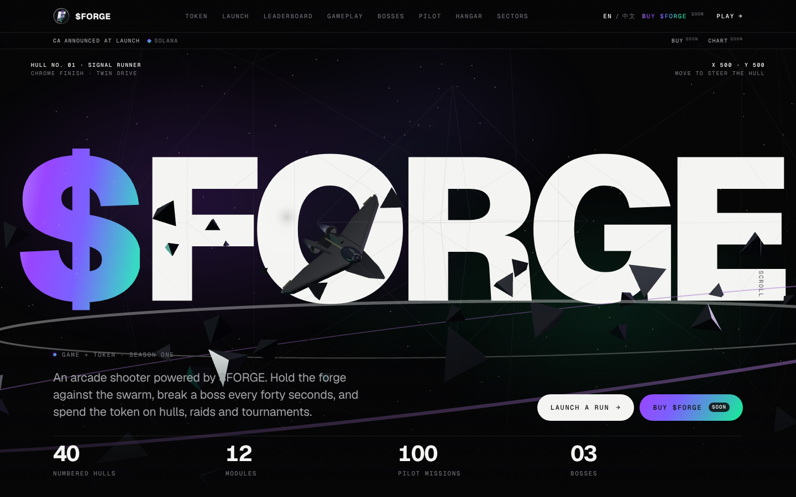
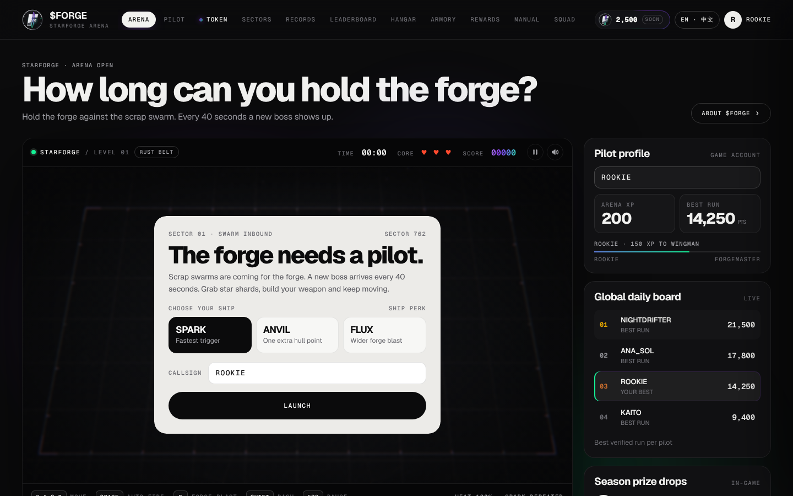
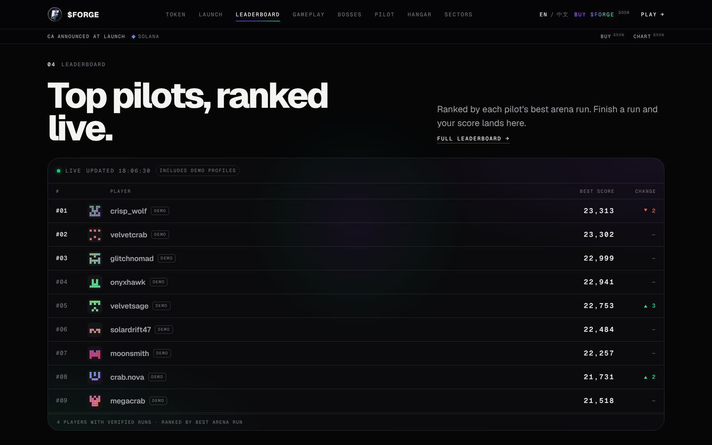
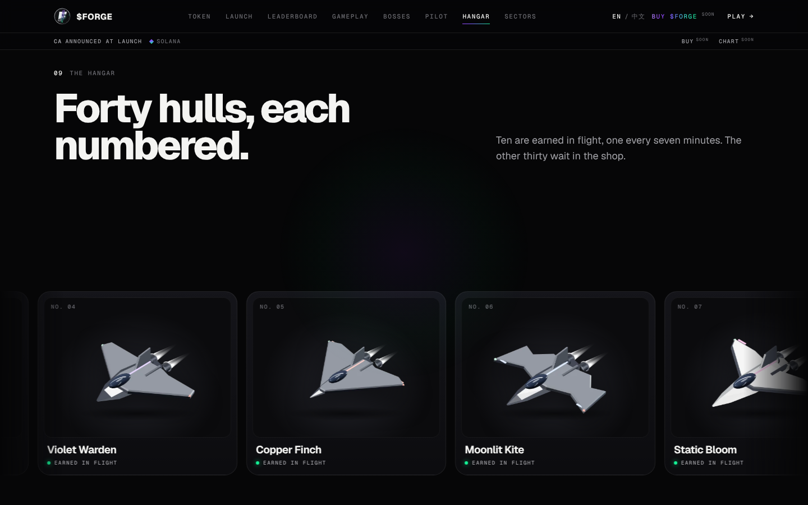
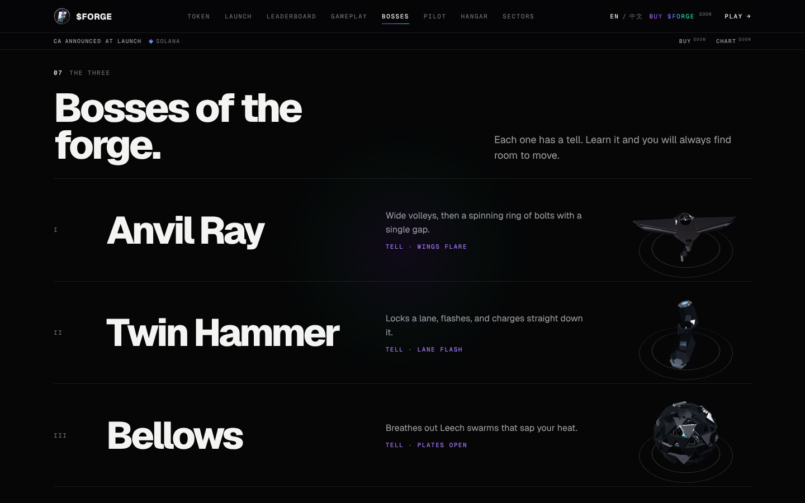
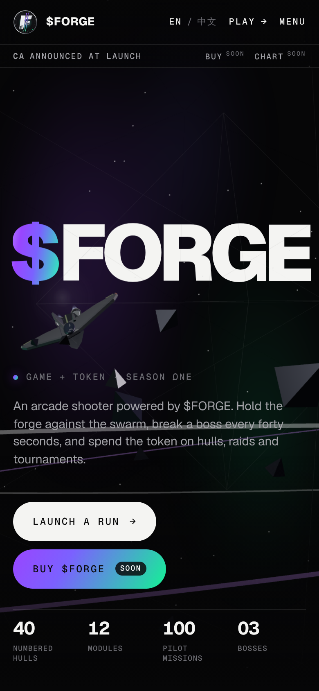
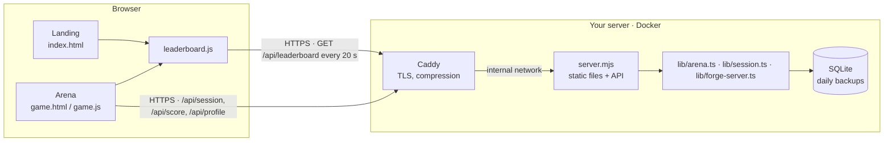
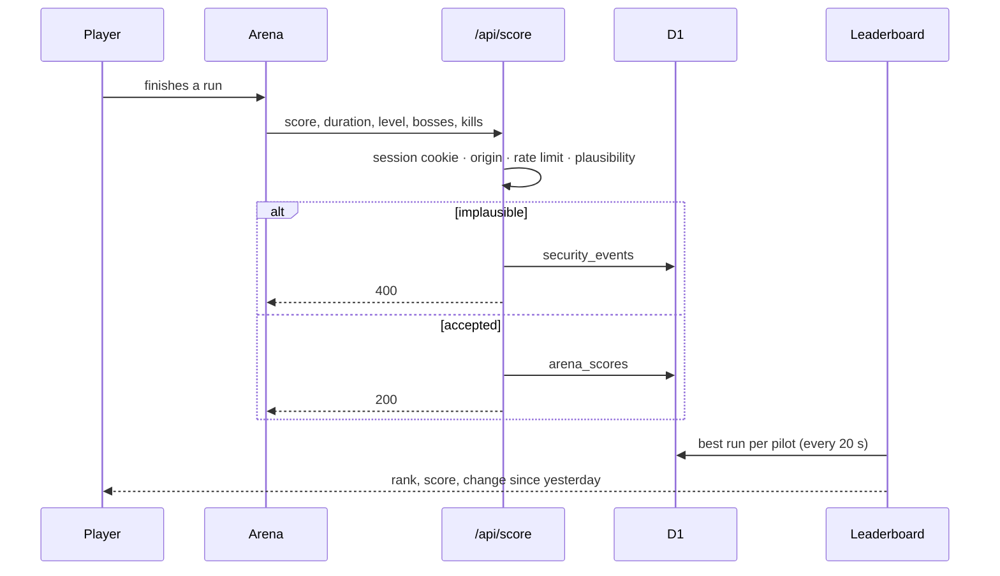

<p align="center">
  
</p>

<h1 align="center">$FORGE · Starforge Arena</h1>

<p align="center">
  <b>A browser arcade shooter with a pilot leaderboard, built for a Solana token launch.</b><br/>
  Hold the forge against the swarm, break a boss every forty seconds, climb the board.
</p>

<p align="center">
  
  
  
  
  
</p>

<p align="center"><a href="README.ru.md">Русская версия</a></p>



## What it is

Starforge is a fast, one-screen arcade shooter that runs in the browser with no install. Players pick a hull, survive a scrap swarm, defeat a boss every 40 seconds and push their best run onto a shared leaderboard. The landing page presents the game and the upcoming **$FORGE** token on Solana.

## How it works

1. **Play.** Pick a ship (Spark, Anvil or Flux) and survive. Shards build your weapon; bosses arrive on a timer.
2. **Join.** No registration: the first finished run creates the pilot under the chosen callsign and signs the browser in with an HttpOnly session cookie.
3. **Submit.** Each finished run is posted to `POST /api/score`.
4. **Check.** The server rate-limits submissions and rejects runs that are impossible for their length (score, level, bosses and kills against duration). Rejected runs are written to a security log.
5. **Rank.** `GET /api/leaderboard` ranks every pilot by their best verified run and shows how each position moved since yesterday.
6. **Watch.** The board updates every 20 seconds without a reload. Rows glide to new positions; risers flash green, fallers red.

## Screenshots

| Arena | Leaderboard |
|---|---|
|  |  |
| **Hangar** | **Bosses** |
|  |  |

<p align="center"></p>

## Project status

Starforge is **pre-launch**. Be clear about what is live and what is not:

| Part | State |
|---|---|
| Landing page, arena, pilot campaign, hangar | Live in the build |
| Pilot accounts without registration, score, shop, raid and leaderboard APIs | Implemented, tested end-to-end |
| Self-hosted deployment (Docker + Caddy, automatic HTTPS, backups) | Ready; see [DEPLOY.md](DEPLOY.md) |
| Leaderboard demo profiles | Generated in the browser, always tagged **DEMO**, never stored |
| $FORGE token, buy and chart links | **Not launched.** The contract address will be announced at launch |
| Run tickets (a run can't be submitted faster than real time, each counts once) | Implemented |
| Server-side replay verification of runs | Not yet; see [Limitations](#limitations) |

## Architecture





## Repository structure

```
apps/
  arcade/                 the app (site, arena, API) and its Dockerfile
    server/               self-hosted server (Node 22 + SQLite, no npm deps)
    lib/                  shared logic: board, arena services, sessions, security checks
    app/api/              Next.js wrappers for the original host
    db/ · drizzle/        schema and SQL migrations
    public/               landing, arena, leaderboard, assets (served as static files)
    scripts/              dev server and tests
packages/
  brand/                  logo, favicon, color tokens
infra/                    compose stack, Caddyfile, server setup, deploy and backup scripts
docs/                     security model (docs/ru — Russian guides)
.github/                  CI and README media
```

## Run locally

Requirements: **Node.js 22.13+**.

No install needed — the server uses only Node's built-ins:

```bash
cd apps/arcade
COOKIE_SECURE=0 DEV_SEED=1 node --experimental-strip-types server/server.mjs
# open http://127.0.0.1:3000  (a few sample players on the board)
```

Tests:

```bash
cd apps/arcade
node scripts/test-forge-server.mjs     # board logic on SQLite
node scripts/test-server-http.mjs      # 59 end-to-end security checks against the real server
```

Production on your own server (Docker + automatic HTTPS):

```bash
sudo bash infra/setup-ubuntu.sh --deploy-user forge   # firewall, fail2ban, updates, Docker
cd infra && cp .env.example .env && nano .env          # DOMAIN, ACME_EMAIL
docker compose up -d --build
```

Full guide: [DEPLOY.md](DEPLOY.md) · по-русски: [docs/ru/VPS-RU.md](docs/ru/VPS-RU.md).

## Security

- Sessions: random 256-bit token in a `__Host-` HttpOnly, Secure, SameSite cookie; only its hash is stored.
- No identity from headers: forged hosting sign-in headers are stripped.
- Every write is same-origin (CSRF), JSON-only and size-capped.
- Rate limits per IP and per player on sign-up, runs, actions and the board; IPs that keep getting refused are blocked automatically.
- One-time run tickets: a score is accepted only if its run started on the server at least as long ago as it lasted.
- One-time recovery codes (~99 bits, stored hashed) and at most 5 active sessions per pilot.
- Plausibility checks on every run; rejected runs are logged to `security_events`.
- Unique callsigns with reserved staff-like names; server-side prices; one-time referral pay-outs.
- Strict CSP with no inline scripts, HSTS, frame, referrer and permissions policies; unknown Host headers refused.
- Hardened container: non-root, read-only, no capabilities, no internet; host firewall and fail2ban.

Details in [docs/security.md](docs/security.md). To report a vulnerability, see [SECURITY.md](SECURITY.md).

## Limitations

- Scores are computed in the browser. The server rejects impossible runs and runs faster than real time, but someone who really plays for a while can still inflate that run's score within the plausible range. Full protection requires replaying the run on the server from its seed and input log.
- Volumetric DDoS protection belongs at the network edge (Cloudflare proxy or the host's protection).
- A pilot who clears the browser without saving a recovery code loses access to it.

## License

Copyright © Starforge. All rights reserved. The source is published for reading and review only; see [LICENSE](LICENSE).

---

<sub>Nothing in this repository is financial advice. $FORGE has not launched; any token, price or chart reference describes planned features only. Crypto assets are volatile and you can lose everything you put in.</sub>
