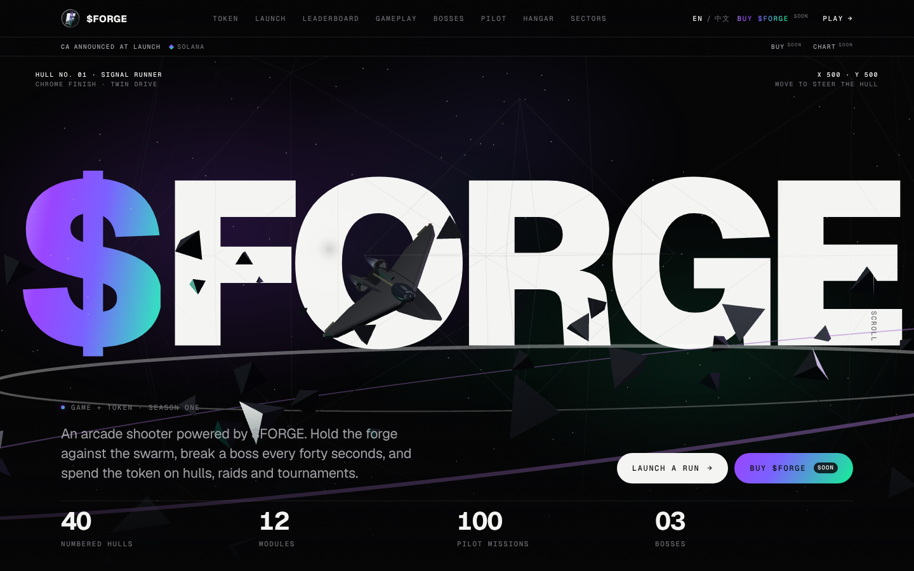

<p align="center"></p>

<h1 align="center">$FORGE · Starforge Arena</h1>

<p align="center"><b>Браузерный аркадный шутер с рейтингом пилотов, сделанный под запуск токена на Solana.</b></p>

<p align="center"><a href="README.md">English</a></p>



## Что это
Быстрый шутер на один экран, который запускается прямо в браузере. Игрок выбирает корабль, выживает против роя, каждые 40 секунд побеждает босса и попадает со своим лучшим забегом в общий рейтинг. Лендинг представляет игру и будущий токен **$FORGE**.

## Как это работает
1. **Игра.** Выбор корабля (Spark, Anvil, Flux), выживание, боссы по таймеру.
2. **Отправка.** Забег вошедшего игрока уходит на `POST /api/score`.
3. **Проверка.** Сервер ограничивает частоту отправки и отклоняет невозможные забеги. Отклонённые пишутся в журнал безопасности.
4. **Рейтинг.** `GET /api/leaderboard` ранжирует пилотов по лучшему проверенному забегу и показывает изменение места со вчерашнего дня.
5. **Обновление.** Рейтинг обновляется каждые 20 секунд без перезагрузки, строки плавно переезжают.

## Статус
Проект **до запуска**:
- лендинг, арена, кампания, ангар — работают;
- игровые аккаунты, API забегов и рейтинга — готовы и покрыты тестами;
- демо-профили в рейтинге — генерируются в браузере, всегда с меткой **DEMO**, в базу не попадают;
- токен $FORGE, покупка и график — **ещё не запущены**, адрес контракта объявят при запуске.

## Запуск
Нужен **Node.js 22.13+**.

```bash
cd apps/arcade
node scripts/dev-forge-server.mjs public 8790   # быстрый просмотр без установки
node scripts/test-forge-server.mjs              # тесты
corepack pnpm install && corepack pnpm build    # полная сборка
```

Выкатка — в [DEPLOY.md](DEPLOY.md), подробные заметки на русском — в [docs/ru](docs/ru).

## Лицензия
Все права защищены. Код открыт только для чтения, см. [LICENSE](LICENSE).

<sub>Это не финансовый совет. $FORGE не запущен; упоминания токена описывают только планы.</sub>
